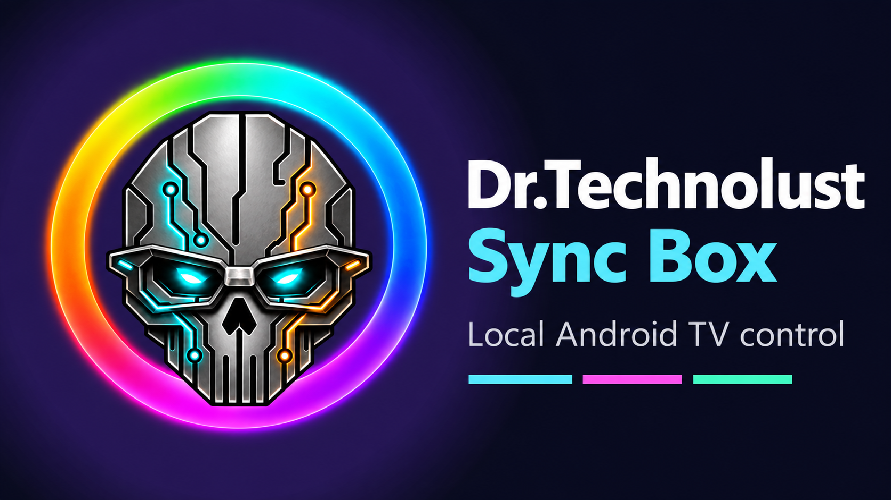
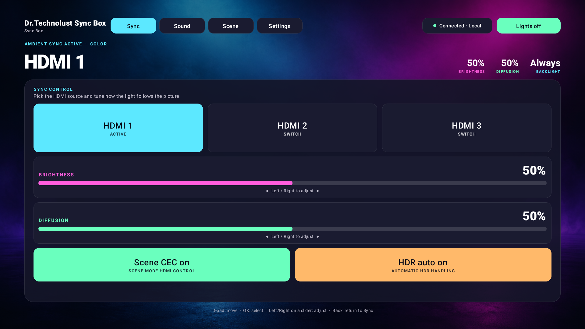
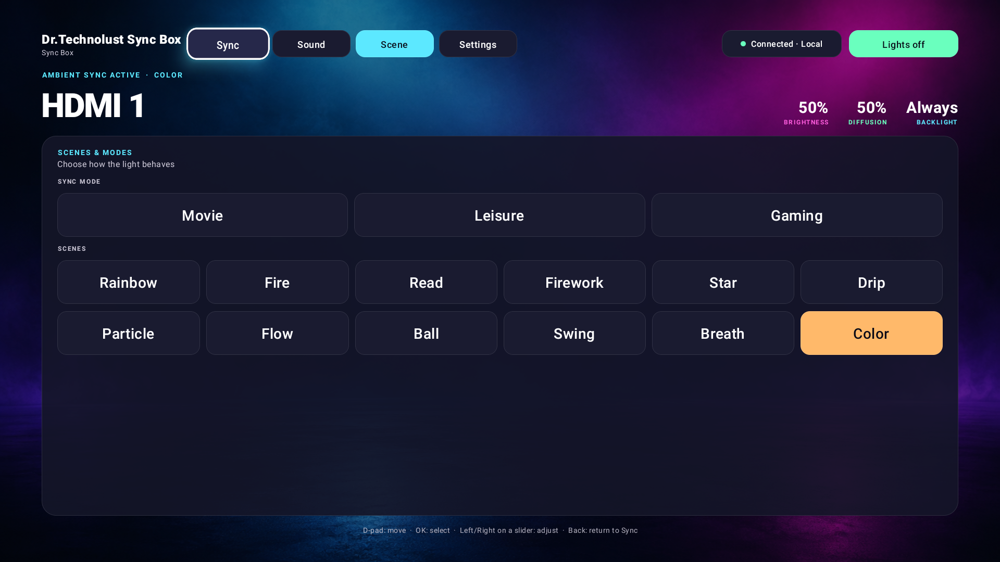
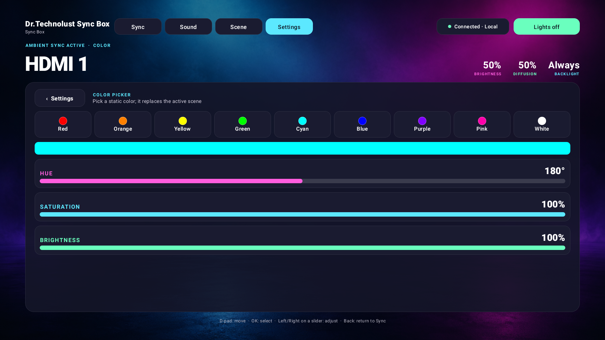

# Dr.Technolust Sync Box

An Android TV remote for the **FancyLEDs F62 3 HDMI 2.1 Sync Box**. Once set up,
it talks directly to the box over your home network: no account login or cloud
connection in this app. Obtaining the device's local key is a separate setup step.

> **Unofficial.** Independent community project. Not affiliated with, endorsed
> by or supported by FancyLEDs or Tuya. Product names are trademarks of their
> respective owners and are used only to describe compatibility.

Developed by **Dr. Technolust**.



**First public release: 1.0.3.** Unofficial local controller, physically tested
with the F62 and NVIDIA Shield. You must supply your own box's local key.

[Download signed APK](https://github.com/drtechnolust/Dr-Technolust-Sync-Box/releases/latest)
· [Watch the app walkthrough](https://github.com/drtechnolust/Dr-Technolust-Sync-Box/releases/download/v1.0.3/Dr-Technolust-Sync-Box-Walkthrough.mp4)
· [All screenshots](https://github.com/drtechnolust/Dr-Technolust-Sync-Box/releases/download/v1.0.3/Dr-Technolust-Sync-Box-Screenshots.zip)







## What it does

- HDMI input, brightness, diffusion, TV sync and HDR auto
- Brightness, diffusion and percentage sliders adjust in 1% steps with the remote
- Sync modes (Movie, Leisure, Gaming), 12 scenes and 6 sound-reactive modes
- Wireless sync channel, ambient backlight, LED strip orientation
- Color enhancement and per-channel color calibration (R, G, B, W, ±10%)
- D-pad-first TV interface with a safety guard when switching HDMI inputs
- Static color picker with live HSV readback, music sensitivity and black-bar detection
- Four saved presets (save/recall/clear); recalling a preset never changes HDMI
- Persisted sleep timer, auto-on when the app starts, and daily on/off schedules
- Schedule times default to AM/PM, with a saved 12-hour/24-hour switch
- Scene Mode CEC uses DP 109; the Sync shortcut and Installation setting share live state

### Complete control list

- Lights on/off; HDMI 1/2/3 with confirmation and automatic-return guard.
- Brightness and diffusion in 1% steps; Scene Mode CEC and HDR auto switches.
- Sync modes: Movie, Leisure, Gaming.
- Scenes: Rainbow, Fire, Read, Firework, Star, Drip, Particle, Flow, Ball,
  Swing, Breath, Color.
- Sound modes: Classic, Pop, Rock, Absolute, Electronic, Ambient; Low/Medium/High
  sensitivity where the box accepts the setting.
- Static colors: Red, Orange, Yellow, Green, Cyan, Blue, Purple, Pink, White,
  plus adjustable hue/saturation/value. Hue uses 5-degree steps.
- Installation: Left/Right strip orientation and Auto/Full screen/Widescreen
  black-bar detection. Color enhancement; R/G/B/W calibration from -10% to +10%.
- Ambient: CH1/CH2/CH3 wireless sync and Mixed/Always/Off backlight.
- Four preset slots (Movie night, Gaming, Late night, Daytime), save/recall/clear;
  15/30/60/90-minute sleep timer; startup auto-on; daily on/off schedules with
  12/24-hour display. Presets never change HDMI input.
- Local discovery/manual setup, encrypted key storage, reconnect, guarded forget,
  offline controls, live device status, and explicitly unconfirmed values.

Not implemented: ambient-level encoding and the phone app's discrete diffusion/
saturation-level buttons. Color-picker saturation is supported. Unreported
calibration starts at a clearly labeled default, not a claimed device reading.

## Tested hardware

| Device | Status |
| --- | --- |
| FancyLEDs 3 HDMI 2.1 Sync Box, product ID `h2nqrmaskyhckcmf` (firmware UI2.2-BLE) | Verified |
| Other FancyLEDs boxes (different product IDs) | Untested: data points may differ |
| Android TV: NVIDIA Shield (Android 11+) | Verified |

Only the F62 product/data-point schema above is verified. This is not a universal
Tuya controller: another box using protocol 3.4 can have different commands.
Protocol 3.5 is not supported. Android 16 TV (API 36) is also covered by emulator
setup/navigation, alarm-permission, and connection-recovery checks.

## Install

1. Download **Dr-Technolust-Sync-Box-1.0.3.apk** from the release and check its SHA-256
   against **SHA256SUMS.txt**. Do not install a file from an untrusted mirror.
2. Sideload with your TV's file manager, or use `adb connect <tv-ip>:5555` then
   `adb -s <tv-ip>:5555 install -r Dr-Technolust-Sync-Box-1.0.3.apk`.
3. Open **Dr.Technolust Sync Box** from the TV launcher.

Updating a release signed with the same certificate preserves setup and presets.
Old development/debug APKs have a different certificate and cannot be updated
in place with this release. Record your local key before uninstalling a development
build: uninstalling removes its setup, presets and schedules. Never post that key.

To build from source, install JDK 17 and Android SDK 36, open the folder in Android
Studio, or run `./gradlew :app:assembleDebug` (`.\gradlew.bat` on Windows).
Gradle 8.14.3 and its distribution checksum are pinned by the included wrapper.

## Build it yourself, from a clean checkout

1. Install **JDK 17** and Android Studio (or the Android command-line SDK).
2. In Android SDK Manager install **Android SDK Platform 36**, **Build-Tools
   34.0.0**, and **Platform-Tools**. Accept the SDK license prompts there.
3. Clone or unzip this repository. No manufacturer SDK, cloud app key, account
   secret, private Gradle repository or publisher signing key is required.

   ```sh
   git clone https://github.com/drtechnolust/Dr-Technolust-Sync-Box.git
   cd Dr-Technolust-Sync-Box
   ```
4. Set Android Studio's **Gradle JDK to 17**. With the command line, set
   `JAVA_HOME` to your JDK 17 directory and `ANDROID_HOME` to your SDK directory.
   Alternatively let Android Studio generate your local `local.properties`.
   Never commit that machine-specific file.
5. Build and test:

   ```powershell
   # Windows PowerShell, from the repository root
   .\gradlew.bat :app:assembleDebug :app:testDebugUnitTest :tuya-lan:test
   ```

   ```sh
   # macOS/Linux, from the repository root
   chmod +x gradlew
   ./gradlew :app:assembleDebug :app:testDebugUnitTest :tuya-lan:test
   ```

6. Your personal APK is `app/build/outputs/apk/debug/app-debug.apk`. Install with
   `adb -s <tv-serial> install -r app/build/outputs/apk/debug/app-debug.apk`, open
   the app and complete **First-run setup** below. No device key is built into it.

The first build downloads Gradle/dependencies from their official repositories.
The clean exported source was independently built and its 19 unit/protocol tests
passed without local properties, signing files or device credentials.
Network access is needed to build, not for vendor-cloud control at runtime.
Your debug/self-signed build has a different signing identity from the official
download; Android will not install it over the official APK. Save your local key
and understand that uninstalling deletes app data before switching identities.

To make your own release, create your own signing configuration. On Windows use
`tools/init_signing.ps1`; on other platforms generate your own keystore with
`keytool` and create a private `keystore.properties` in the root with these names:

```properties
storeFile=/absolute/path/to/your-release.p12
storePassword=YOUR_OWN_PRIVATE_PASSWORD
keyAlias=YOUR_OWN_ALIAS
keyPassword=YOUR_OWN_PRIVATE_PASSWORD
```

Then build `:app:assembleRelease`. Never ask for or reuse the publisher's key,
commit your passwords, or distribute your private signing files.

## First-run setup

1. Choose **Find my box**. The app listens for the box's local network
   announcement and fills in its address and device ID.
2. Enter the box's 16-character **local key** (see [docs/GET_LOCAL_KEY.md](docs/GET_LOCAL_KEY.md)).
3. Choose **Save and connect**.

The key is stored encrypted with the Android Keystore, never logged, and used
only to authenticate local device sessions. The key field is masked. Discovery
can hear other Tuya-based devices; select your F62 box, not an unrelated device.

## Limits

- The box does not report some settings over the local network. Channel,
  ambient backlight, music sensitivity and black-bar detection show the last
  command as **Sent · Unconfirmed** unless the box actually reports a value.
  Calibration remembers the last acknowledged value set from this TV.
- The ambient level slider is not available. Scene Mode CEC can be configured
  locally; actual TV standby/wake behavior depends on the HDMI CEC chain.
- Sleep timers survive activity/process recreation and reboot. Keep the TV
  powered and the box reachable. Android force-stop disables automation until
  the app is opened again. Android 12+ can use approximate timing without alarm
  access; the Timers/Schedule screens offer access to precise-alarm settings.
- Switching HDMI to a port without a source blanks the picture; the HDMI guard
  returns to the previous input automatically unless you confirm.

## Verification and release

See [docs/VERIFICATION.md](docs/VERIFICATION.md) for tests and the remaining
hardware-observation limits. Version 1.0.3 adds permanent release signing,
explicit setup-field remote navigation, non-blocking disconnect handling,
offline control guards, atomic encrypted storage and backup/transfer exclusions.

Release builds fail without a signing configuration; there is no debug-key
fallback. On Windows, `tools/init_signing.ps1` creates your own private signing
identity and `keystore.properties`. Keep the entire private signing directory
and properties secure and backed up offline. Never include them in a release.
Then run `./gradlew :app:assembleRelease` and `tools/verify_release.ps1`.

## Privacy

There are no accounts, ads, analytics, tracking SDKs or cloud API calls in the
Android app. It uses the Internet/network permission for LAN discovery and direct
TCP device commands. Configuration stays encrypted on this TV; looks and schedules
stay in app-private storage. Backup and device transfer are excluded because the
encryption key is device-bound. Forget box removes the box credentials; uninstall
removes all app data. Connection diagnostics log error types, not the local key.
This does not change how the box's own firmware or other apps use vendor services.
The optional desktop key-retrieval helper contacts your own Tuya cloud account,
separately from the Android app, and prints credentials locally: do not share its output.

## Reporting an issue

Include app version, TV model/Android version, box model/firmware, the steps and
what happened. Redact local keys, API secrets, device IDs, account information and
connection-screen screenshots. Other product models are untested, not promised.

## Credits and licenses

- Protocol details are documented by the open-source Tuya LAN community
  (for example `tinytuya` and `tuya-local`); this app contains none of their code.
- Data-point meanings were verified on a real box. See [DP_MAP.md](DP_MAP.md).
- Licensed under the MIT License. See [LICENSE](LICENSE). The logo artwork is
  © Dr. Technolust, all rights reserved, and is not covered by the MIT license.
